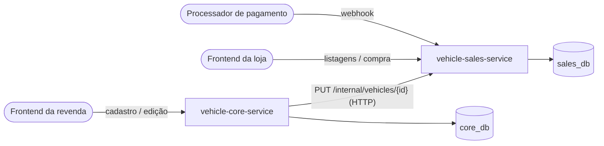

# vehicle-core-service

Serviço principal da plataforma de revenda de veículos (Tech Challenge SOAT, Fase 4, trabalho substitutivo).
Cuida do **cadastro e da edição de veículos** e repassa cada alteração, por HTTP, ao
[serviço de venda](https://github.com/DanielSteil/vehicle-sales-service), que é isolado, tem banco próprio e
atende as listagens, a compra e o webhook de pagamento.

> A arquitetura completa (diagramas, decisões, modelo de dados e fluxos) está em
> [docs/arquitetura.md](docs/arquitetura.md).

## Visão geral



| Requisito do enunciado | Onde está |
|---|---|
| Cadastrar veículo (marca, modelo, ano, cor, preço) | `POST /vehicles` neste serviço |
| Editar os dados do veículo | `PUT /vehicles/{id}` neste serviço |
| Efetuar a venda (CPF e data) | `POST /sales` no serviço de venda |
| Webhook de pagamento (efetuado ou cancelado) | `POST /webhooks/payments` no serviço de venda |
| Listar veículos à venda, por preço crescente | `GET /vehicles/available` no serviço de venda |
| Listar veículos vendidos, por preço crescente | `GET /vehicles/sold` no serviço de venda |
| Banco diferente do serviço de venda | PostgreSQL `core_db`, em instância própria |
| Comunicação via HTTP | `SalesServiceClient` → `PUT /internal/vehicles/{id}` |
| Deployments e Services | [`k8s/`](k8s) |
| CI/CD com Pull Request, deploy no merge | [`.github/workflows/`](.github/workflows) |

## Como foi implementado

- **Java 25 + Spring Boot 4.1**, Spring Web MVC, Spring Data JPA, Flyway, Bean Validation, Actuator e springdoc (Swagger).
- **Clean Architecture:** `domain` (regras, sem framework) → `application` (casos de uso e portas) → `infrastructure` (REST, JPA, cliente HTTP, configuração).
- **Integração com o serviço de venda:** `RestClient` com timeout. Repete a chamada em falhas transitórias (seguro, porque o `PUT` pode ser repetido sem efeito) e não repete em erros 4xx.
- **Consistência entre os bancos:** a gravação local e a chamada ao serviço de venda acontecem na mesma transação. Se o serviço de venda recusar (`409`, veículo reservado ou vendido) ou estiver fora do ar (`503`), nada é gravado.
- **Concorrência:** lock otimista (`version`). Duas edições simultâneas não se sobrescrevem: a segunda recebe `409`.
- **Erros** no padrão RFC 9457 (`application/problem+json`).

### Endpoints

| Método | Caminho | Descrição | Respostas |
|---|---|---|---|
| `POST` | `/vehicles` | Cadastra e publica no serviço de venda | 201, 400, 422, 502, 503 |
| `PUT` | `/vehicles/{id}` | Edita e publica a alteração | 200, 400, 404, 409, 422, 502, 503 |
| `GET` | `/vehicles/{id}` | Consulta o cadastro | 200, 404 |
| `GET` | `/vehicles?page=0&size=20` | Lista o cadastro (mais recentes primeiro) | 200, 400 |
| `GET` | `/swagger-ui.html` | Documentação interativa | |
| `GET` | `/actuator/health/{liveness,readiness}` | Probes do Kubernetes | |

## Como usar localmente

Pré-requisitos: Docker. Para compilar fora do Docker, também JDK 25 e Maven 3.9.

Clone os dois repositórios lado a lado e suba a plataforma inteira (2 serviços e 2 bancos):

```bash
git clone https://github.com/DanielSteil/vehicle-core-service.git
git clone https://github.com/DanielSteil/vehicle-sales-service.git
cd vehicle-core-service
docker compose up -d --build
```

| Componente | Endereço |
|---|---|
| Serviço principal | http://localhost:8081 (Swagger: http://localhost:8081/swagger-ui.html) |
| Serviço de venda | http://localhost:8082 (Swagger: http://localhost:8082/swagger-ui.html) |
| `core_db` / `sales_db` | `localhost:15432` / `localhost:15433` |

Segredos padrão do ambiente local: `X-Internal-Token: local-internal-token` e `X-Webhook-Secret: local-webhook-secret`.

### Exemplo do fluxo completo

```bash
# 1. cadastro (serviço principal)
curl -s -X POST localhost:8081/vehicles -H 'Content-Type: application/json' \
  -d '{"brand":"Toyota","model":"Corolla","year":2022,"color":"Prata","price":120000.00}'

# 2. vitrine (serviço de venda), do mais barato para o mais caro
curl -s localhost:8082/vehicles/available

# 3. compra: devolve o paymentCode
curl -s -X POST localhost:8082/sales -H 'Content-Type: application/json' \
  -d '{"vehicleId":"<id>","buyerCpf":"529.982.247-25"}'

# 4. o processador de pagamento confirma
curl -s -X POST localhost:8082/webhooks/payments -H 'Content-Type: application/json' \
  -H 'X-Webhook-Secret: local-webhook-secret' -d '{"paymentCode":"<paymentCode>","status":"PAID"}'

# 5. vendidos, do mais barato para o mais caro
curl -s localhost:8082/vehicles/sold
```

Ou rode o roteiro inteiro automatizado, com verificações em cada passo:

```bash
./scripts/e2e.sh
```

## Como testar

```bash
mvn verify
```

- **Testes unitários:** domínio, casos de uso e cliente HTTP (com `MockRestServiceServer`, cobrindo nova tentativa, 409, 401 e timeout).
- **Testes de integração:** a aplicação inteira contra um **PostgreSQL real (Testcontainers)** e o serviço de venda simulado por **WireMock** (HTTP de verdade). Cobrem desfazer a gravação quando o serviço de venda falha, o `409` de veículo reservado, a nova tentativa que dá certo e o lock otimista.
- **Cobertura:** o JaCoCo faz o build falhar abaixo de **80% das linhas**. Hoje está em **98,6% de linhas e 86,4% de branches**. O relatório fica em `target/site/jacoco/index.html` e também é publicado como artefato em cada execução do CI.

> O Docker precisa estar rodando, porque os testes de integração sobem contêineres.

## Deploy (Kubernetes)

Os manifests ficam em [`k8s/`](k8s) e são organizados pelo Kustomize:

| Arquivo | Recurso |
|---|---|
| `namespace.yaml` | Namespace `vehicle-platform` |
| `core-db.yaml` | `StatefulSet` + `Service` do PostgreSQL do serviço principal, com `PersistentVolumeClaim` |
| `configmap.yaml` | URL do banco e do serviço de venda (`http://vehicle-sales-service`, DNS interno) |
| `deployment.yaml` | `Deployment` com startup, liveness e readiness probes, requests e limits |
| `service.yaml` | `Service` NodePort 30081 |

Deploy manual (o mesmo script que o pipeline usa):

```bash
IMAGE=ghcr.io/danielsteil/vehicle-core-service:latest \
CORE_DB_PASSWORD=<senha> INTERNAL_API_TOKEN=<token compartilhado com o serviço de venda> \
KUBE_CONTEXT=minikube ./scripts/deploy.sh
```

> **Senha do banco:** o PostgreSQL só aplica `CORE_DB_PASSWORD` na primeira inicialização do volume. Para trocar a
> senha depois, recrie o volume (`kubectl -n vehicle-platform delete statefulset core-db && kubectl -n vehicle-platform delete pvc data-core-db-0`)
> e rode o deploy de novo.

Para acessar de fora do cluster: `kubectl -n vehicle-platform port-forward svc/vehicle-core-service 18081:80`.
Depois que os dois serviços estiverem no cluster, `WEBHOOK_SECRET=<segredo> KUBE_CONTEXT=minikube ./scripts/e2e-k8s.sh`
roda o teste ponta a ponta contra eles.

## CI/CD

| Workflow | Gatilho | O que faz |
|---|---|---|
| [`ci.yml`](.github/workflows/ci.yml) | Pull Request para a `main` | `mvn verify` (testes, Testcontainers, trava de 80%), resumo da cobertura no PR, relatórios como artefato e build da imagem |
| [`cd.yml`](.github/workflows/cd.yml) | Merge na `main` | Roda o CI de novo → publica a imagem no GHCR (`:<sha>` e `:latest`) → carrega a imagem no minikube → deploy no Kubernetes → smoke test |
| [`e2e.yml`](.github/workflows/e2e.yml) | Manual | Teste ponta a ponta contra os dois serviços no cluster |

**Configuração do repositório:**

1. **Proteção da `main`** (Settings → Branches): exigir Pull Request e o check *Build, testes e cobertura* passando.
2. **Secrets** (Settings → Secrets and variables → Actions):
   - `CORE_DB_PASSWORD`: senha do banco do serviço principal.
   - `INTERNAL_API_TOKEN`: o mesmo valor configurado no repositório do serviço de venda.
   - `WEBHOOK_SECRET`: o mesmo valor do serviço de venda (usado só pelo workflow E2E).
3. **Runner auto-hospedado** na máquina do cluster (Settings → Actions → Runners → New self-hosted runner → Windows x64).
   Siga os comandos que o GitHub mostra; no `config.cmd`, informe o label adicional `minikube`. Depois, com o cluster de pé,
   inicie o runner pelo PowerShell com o `bash` do Git no PATH (os passos do deploy usam `shell: bash`):
   ```powershell
   minikube start
   minikube addons enable metrics-server
   $env:Path = "C:\Program Files\Git\bin;" + $env:Path
   .\run.cmd
   ```
   O deploy baixa a imagem do GHCR na própria máquina e a carrega no minikube (`minikube image load`), então o pacote
   pode continuar privado.

> Segurança: o job de deploy só roda em `push` na `main`, nunca em PRs de forks, então código de terceiros não executa no runner auto-hospedado.

## Variáveis de ambiente

| Variável | Padrão local | Descrição |
|---|---|---|
| `DB_URL` | `jdbc:postgresql://localhost:15432/core_db` | URL JDBC do banco do serviço principal |
| `DB_USERNAME` / `DB_PASSWORD` | `core` / `core` | Credenciais do banco |
| `SALES_SERVICE_URL` | `http://localhost:8082` | URL base do serviço de venda |
| `SALES_INTERNAL_TOKEN` | (obrigatória) | Token enviado no header `X-Internal-Token` |
| `PORT` | `8080` | Porta HTTP |
