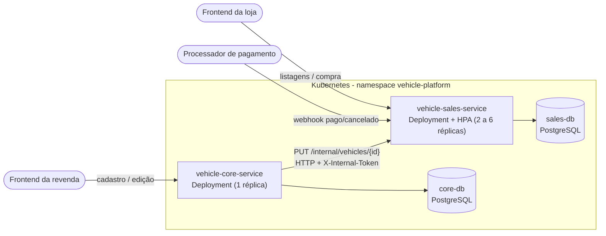
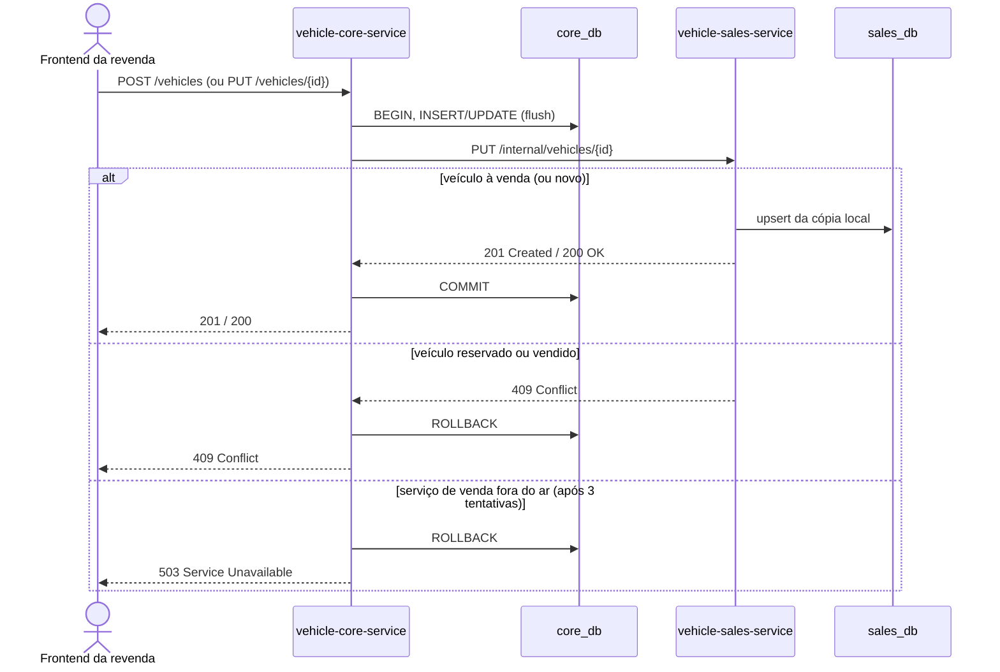
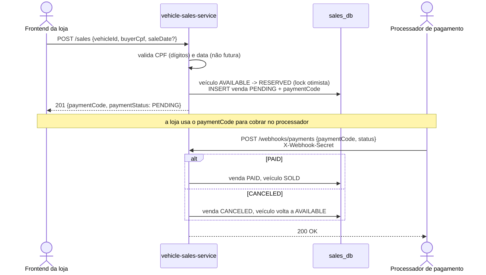
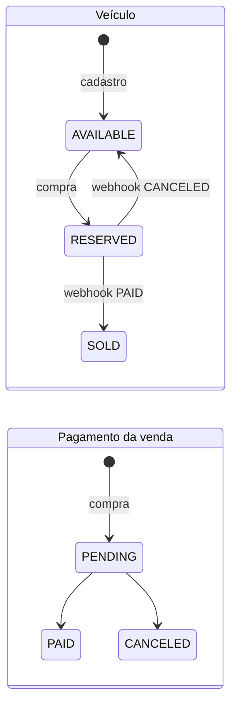
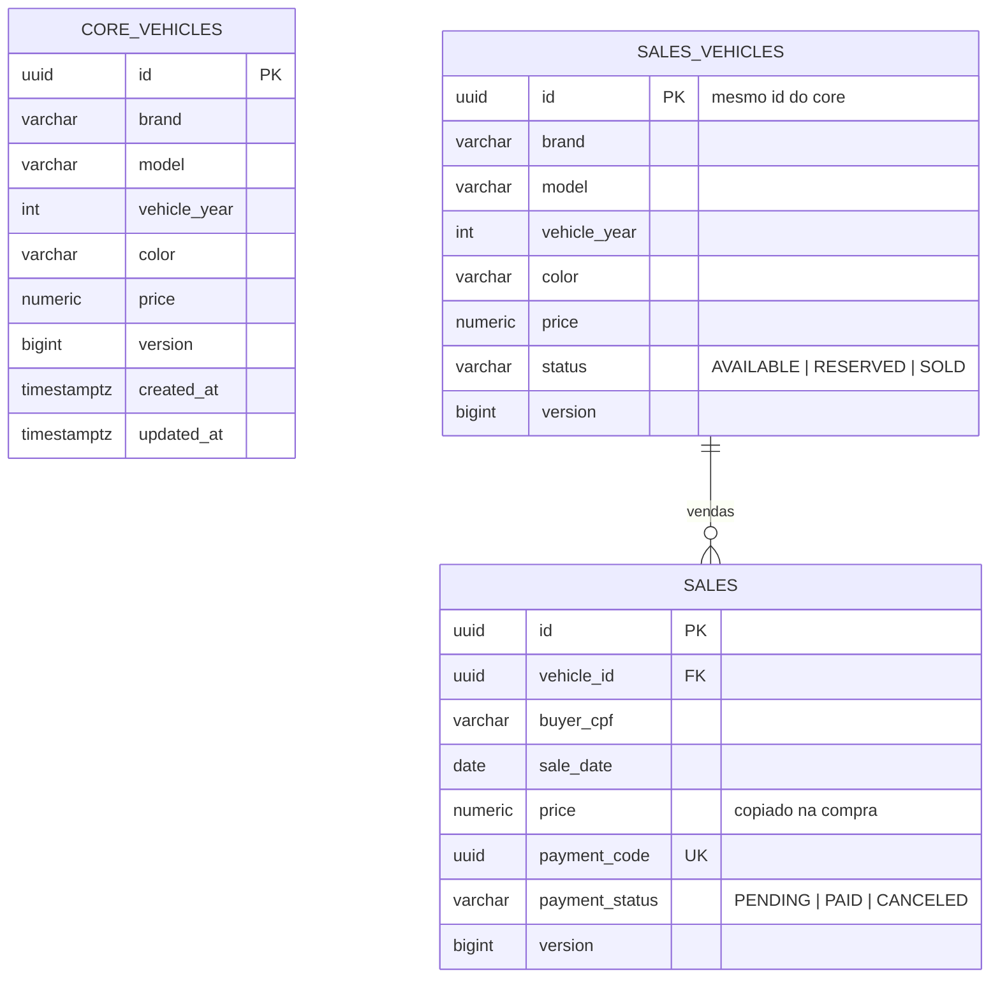

# Arquitetura da plataforma de revenda de veículos

## Visão geral

A plataforma tem dois serviços, cada um com o seu próprio banco PostgreSQL. Eles conversam só por HTTP.

| Serviço | Repositório | Responsabilidade | Banco |
|---|---|---|---|
| **Serviço principal** | `vehicle-core-service` | Cadastro e edição de veículos (fonte da verdade dos dados cadastrais) | `core_db` |
| **Serviço de venda** | `vehicle-sales-service` | Listagens à venda e vendidos, compra e webhook de pagamento (fonte da verdade do status de venda) | `sales_db` |



## Por que esse desenho

**Cópia local dos veículos no serviço de venda.** O enunciado pede que listagens e compras fiquem isoladas para aguentar picos de acesso. Por isso o serviço de venda guarda no próprio banco uma cópia dos dados que precisa (marca, modelo, ano, cor e preço). Listar e comprar nunca dependem do serviço principal: num pico, só o serviço de venda escala, pelo HPA, e ele continua vendendo mesmo se o serviço principal estiver fora do ar.

**A chamada vai num sentido só (principal → venda).** O serviço principal avisa o de venda a cada cadastro ou edição. O de venda nunca chama o principal. É ele que sabe se um veículo está à venda, reservado ou vendido. Por isso, quando alguém tenta editar um veículo já reservado, o serviço de venda responde `409` e o principal desfaz a edição. Assim os dois serviços não ficam chamando um ao outro, e cada um decide só sobre o que é dele.

**O webhook fica no serviço de venda.** O enunciado não diz em qual serviço ele fica. Ele está no serviço de venda porque é esse serviço que gera o código de pagamento e cuida da venda do início ao fim. No principal, o webhook só repassaria a chamada.

## Campos que o enunciado não trazia

| Entidade | Campos adicionados | Motivo |
|---|---|---|
| Veículo | `id`, `status` (AVAILABLE, RESERVED, SOLD), `version`, datas | Identificar o veículo entre os serviços, separar à venda de vendido, controle de concorrência |
| Venda | `id`, `price` (copiado na compra), `paymentCode`, `paymentStatus` (PENDING, PAID, CANCELED), `version`, datas | O webhook identifica a venda pelo código de pagamento; o preço não muda se o cadastro for editado depois |

## Fluxos

### Cadastro e edição



- O `PUT` interno pode ser repetido sem efeito colateral. Por isso o cliente HTTP repete a chamada em timeout, conexão recusada ou erro 5xx (3 tentativas, com espera crescente). Erros 4xx não são repetidos.
- Se o serviço de venda falhar, a gravação no serviço principal é desfeita, para que os dois bancos não fiquem divergentes.
- **Limitação conhecida:** se o `COMMIT` local falhar depois que o serviço de venda já aceitou, sobra uma cópia que o principal não tem. A evolução natural é o padrão *Transactional Outbox* (gravar o evento na mesma transação e publicar de forma assíncrona). Ficou fora do escopo para manter a comunicação síncrona por HTTP pedida no enunciado.

### Compra e confirmação do pagamento



- **Dois compradores ao mesmo tempo:** o veículo tem coluna `version` (lock otimista). Só uma compra consegue reservá-lo, e a outra recebe `409`. Além disso, um índice único parcial no banco garante no máximo uma venda ativa por veículo.
- **Webhook idempotente:** processadores de pagamento reenviam notificações. Repetir a mesma notificação devolve `200` sem efeito. Uma notificação contraditória (cancelar algo já pago) devolve `409`.
- **LGPD:** o CPF é guardado completo, mas as respostas da API mostram só os dígitos do meio (`***.982.247-**`).

### Estados



## Modelo de dados

Os bancos são instâncias separadas, sem chave estrangeira entre eles: o `id` do veículo é o único elo, e trafega pela API.



Índices pensados para as listagens: `vehicles (status, price, id)` e `sales (payment_status, price, id)`, que atendem a ordenação do mais barato para o mais caro sem varrer a tabela.

## Organização do código (Clean Architecture)

Os dois serviços seguem as mesmas camadas. As dependências apontam sempre para dentro:

```
domain/          entidades e regras de negócio (Vehicle, Sale, Cpf): Java puro, sem framework
application/     casos de uso + portas (interfaces de repositório, gateway HTTP, UnitOfWork)
infrastructure/  adaptadores: controllers REST, JPA, cliente HTTP, segurança, configuração Spring
```

- Os casos de uso não conhecem o Spring. São montados em `UseCaseConfig`, e a transação entra pela porta `UnitOfWork`, implementada com `TransactionTemplate`.
- Isso permite testar domínio e casos de uso com objetos em memória, sem subir a aplicação.

## Segurança entre componentes

| Chamada | Proteção |
|---|---|
| Serviço principal → `PUT /internal/vehicles/{id}` | Header `X-Internal-Token` (segredo compartilhado, comparado em tempo constante) |
| Processador de pagamento → `POST /webhooks/payments` | Header `X-Webhook-Secret` |
| Segredos no Kubernetes | `Secret` criado pelo pipeline a partir dos *secrets* do GitHub. Nada sensível fica no repositório |

## Infraestrutura

- **Kubernetes** (minikube local), namespace `vehicle-platform`, com manifests organizados pelo Kustomize em cada repositório.
- Cada serviço tem: `Deployment` (startup, liveness e readiness probes; requests e limits), `Service` (NodePort), `ConfigMap`, `Secret` e um `StatefulSet` de PostgreSQL com `PersistentVolumeClaim` próprio.
- O serviço de venda tem também um `HorizontalPodAutoscaler` (2 a 6 réplicas, alvo de 70% de CPU).
- **CI/CD** com GitHub Actions:
  - Todo PR roda testes unitários e de integração (Testcontainers) e falha abaixo de 80% de cobertura.
  - O merge na `main` publica a imagem no GHCR e faz o deploy no cluster por um runner auto-hospedado.
